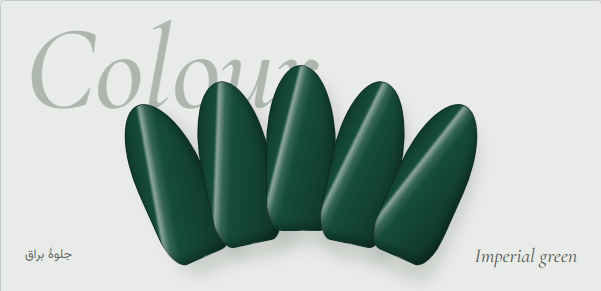

[فارسی](README.md)

# Tina Nail Atelier

<a href="https://mrdalili.ir/tina-preview/">
  <picture>
    <source media="(max-width: 650px)" srcset="docs/readme/atelier-mobile.webp">
    
  </picture>
</a>

Tina Hosseinzadeh runs a nail studio in Sattarkhan, Tehran. Her Persian-language site lets guests try a nail colour and shape, then book hand or foot care with Tina or Sonia.

**[Visit the atelier](https://mrdalili.ir/tina-preview/)** · [Choose a day and time](https://mrdalili.ir/tina-preview/#booking)

## Burgundy in gloss or matte?

Watch the highlight on the burgundy sample. Switch the same shade to matte and the shine fades. Keep the polish and change the almond tip to a soft square to see what the flatter edge does.

<a href="https://mrdalili.ir/tina-preview/#colour">
  <picture>
    <source media="(prefers-reduced-motion: reduce)" srcset="docs/readme/colour-study.webp">
    
  </picture>
</a>

[Try the colours and shapes on the site](https://mrdalili.ir/tina-preview/#colour)

## One day on two calendars

Say noon to 2 pm is your only free time. On this sample day, Tina is booked for that slot and Sonia is free. Change the specialist in the booking form to see who is available on the same day.

| Time in Tehran | Tina | Sonia |
| --- | --- | --- |
| 10 am–noon | Booked | Open |
| Noon–2 pm | Booked | Open |
| 2–4 pm | Open | Booked |
| 4–6 pm | Open | Open |

Once a booking is confirmed, the receipt shows the specialist, service, Jalali date, time and booking reference. Guests can print it or save it as a PDF. [View a sample receipt](https://mrdalili.ir/tina-preview/receipt-preview/)

[Booking form source](src/features/booking/BookingForm.tsx) · [How the app prevents double booking](docs/booking-runtime.md)
