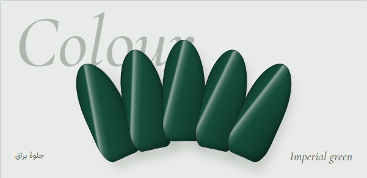

<a href="README.en.md" lang="en">English</a>

# آتلیهٔ ناخن تینا

<a href="https://mrdalili.ir/tina-preview/">
  <picture>
    <source media="(max-width: 650px)" srcset="docs/readme/atelier-mobile.webp">
    
  </picture>
</a>

تینا حسین‌زاده در ستارخان تهران آتلیهٔ ناخن دارد. پیش از مراجعه می‌توانی رنگ و فرم ناخن را امتحان کنی و برای مانیکور یا پدیکور، از تقویم تینا یا سونیا وقت بگیری.

**[دیدن سایت آتلیه](https://mrdalili.ir/tina-preview/)** · [انتخاب روز و ساعت](https://mrdalili.ir/tina-preview/#booking)

## زرشکیِ براق یا مات؟

به خط روشن روی نمونهٔ زرشکی نگاه کن. وقتی همان رنگ را مات می‌کنی، برق روی ناخن محو می‌شود. حالا فرم بادامی را به نیمه‌مربعی تغییر بده تا ببینی همان لاک با نوک صاف‌تر چه شکلی می‌شود.

<a href="https://mrdalili.ir/tina-preview/#colour">
  <picture>
    <source media="(prefers-reduced-motion: reduce)" srcset="docs/readme/colour-study.webp">
    
  </picture>
</a>

[رنگ و فرم دلخواهت را روی سایت امتحان کن](https://mrdalili.ir/tina-preview/#colour)

## یک روز در تقویم تینا و سونیا

فرض کن فقط بین ساعت ۱۲ و ۱۴ وقت داری. در این روزِ نمونه، وقت تینا در آن بازه پُر است و سونیا وقت دارد. در فرم رزرو هم می‌توانی متخصص را عوض کنی و ساعت‌های آزادش را برای همان روز ببینی.

| ساعت به وقت تهران | تینا | سونیا |
| --- | --- | --- |
| ۱۰ تا ۱۲ | پُر | آزاد |
| ۱۲ تا ۱۴ | پُر | آزاد |
| ۱۴ تا ۱۶ | آزاد | پُر |
| ۱۶ تا ۱۸ | آزاد | آزاد |

بعد از ثبت نوبت، یک رسید با نام متخصص، خدمت، تاریخ شمسی، ساعت و کد پیگیری می‌گیری. می‌توانی همان‌جا چاپش کنی یا به‌صورت PDF نگه داری. [دیدن رسید نمونه](https://mrdalili.ir/tina-preview/receipt-preview/)

[کد فرم رزرو](src/features/booking/BookingForm.tsx) · [نحوهٔ جلوگیری از رزرو هم‌زمان یک وقت](docs/booking-runtime.md)

